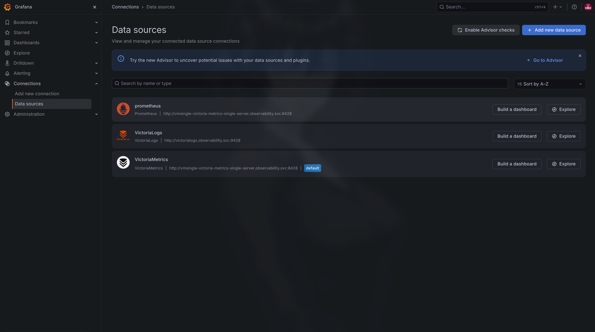
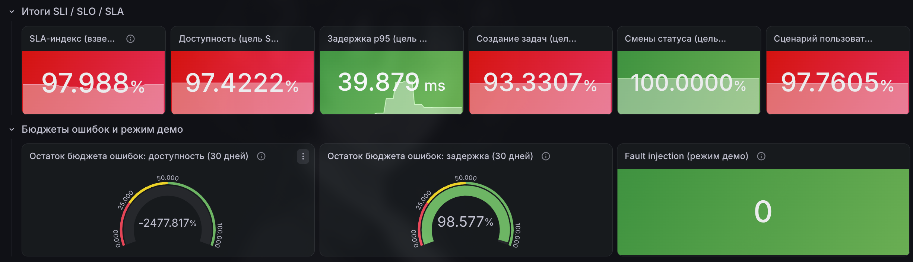
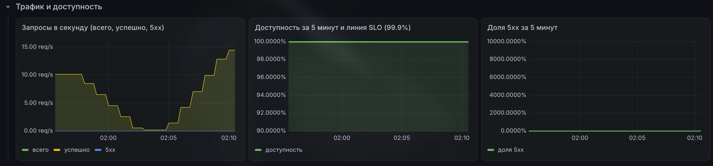
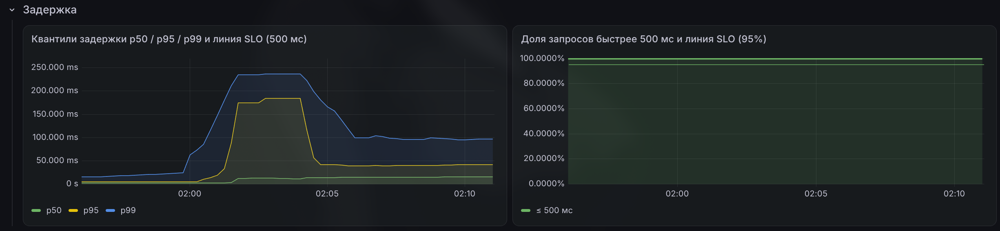
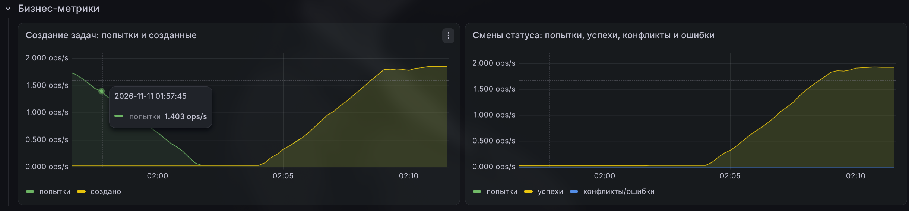
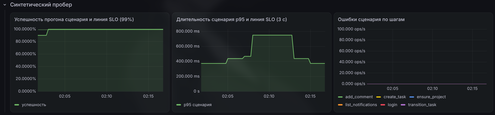
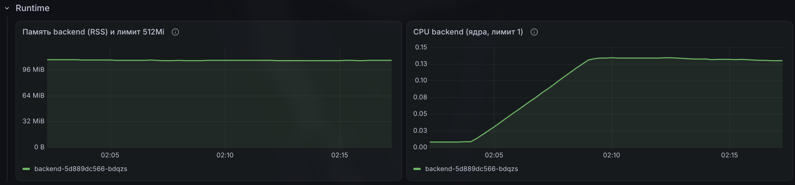
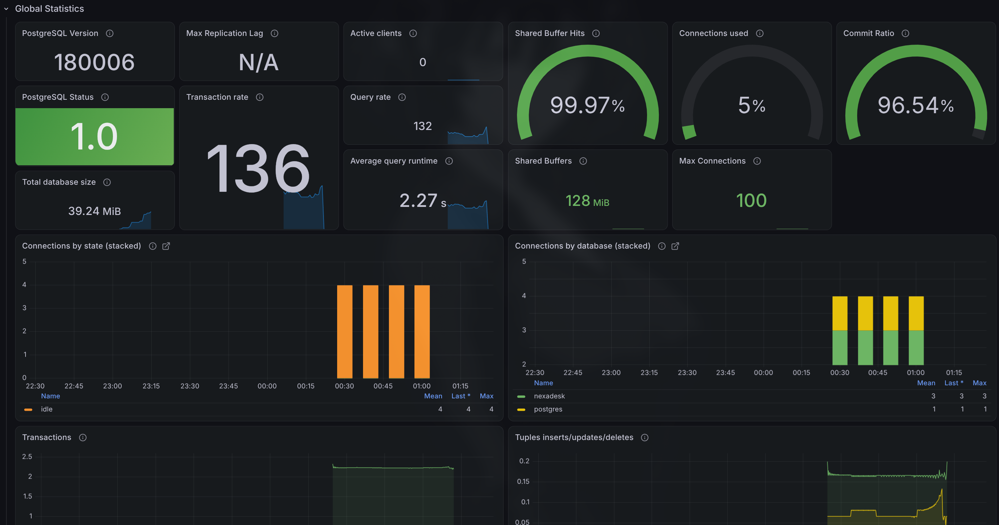

# Дашборд наблюдаемости NexaDesk в Grafana

## 1. Цель работы и стенд

собрать метрики приложения, SLA-расчёты и состояние инфраструктуры в
единый дашборд Grafana, проверить его на живом кластере и показать работу
импортированного дашборда PostgreSQL Exporter.

Стенд:

* minikube, Kubernetes-кластер разработки;
* namespace `observability` — Grafana, VictoriaMetrics, VictoriaLogs, vmalert,
  vmalert-slo, Alertmanager
* namespace `nexadesk` — backend, frontend, PostgreSQL, Redis, синтетический
  пробер
* Grafana `grafana/grafana:13.2.4`, развёрнута манифестами из
  `k8s/observability/monitoring/`
* дашборд и источники данных провижены как код через ConfigMap, поэтому
  воспроизводятся вместе с кластером.

## 2. Источники данных

| Источник | UID | Тип | Назначение |
|---|---|---|---|
| VictoriaMetrics | `vm-metrics` | `victoriametrics-metrics-datasource` | основной источник PromQL-метрик, назначен default |
| VictoriaLogs | `vm-logs` | `victoriametrics-logs-datasource` | логи приложения |
| prometheus | `cg3tkgp0ryfwgd` | `prometheus` | вручную добавленный источник с тем же URL VictoriaMetrics; используется импортированным дашбордом PostgreSQL Exporter |

> **Скриншот 1.** Источники данных.
>
> 

## 3. Дашборд приложения

Дашборд: **«NexaDesk SLI / SLO / SLA»**, каталог `NexaDesk`. Он провижинится из
`k8s/observability/monitoring/grafana-dashboards.yaml`. Экспортированный JSON
лежит в `k8s/observability/monitoring/dashboards/nexadesk-sli-slo.json`.

Всего 32 панели: 8 строк-разделов и 24 панели с данными.

| Блок | Панели | Метрики | Зачем нужен |
|---|---|---|---|
| Итоги SLI / SLO / SLA | SLA-индекс, доступность 30 д, p95, создание задач, смены статуса, сценарий пользователя | recording rules `sli:*` | верхнеуровневый статус: одним взглядом видно, какие обязательства выполняются |
| Бюджеты ошибок и режим демо | остаток бюджета доступности, остаток бюджета задержки, fault injection | `sli:availability:ratio_rate30d`, `sli:latency_le_500ms:ratio_rate30d`, `nexadesk_fault_injection_active` | сколько бюджета ошибок израсходовано и включена ли искусственная деградация |
| Трафик и доступность | RPS (всего / успешно / 5xx), доступность за 5 мин с линией SLO, доля 5xx | `http_requests_total`, `sli:traffic_*`, `sli:availability:*` | RED-traffic и RED-errors |
| Задержка | p50/p95/p99, доля запросов ≤ 500 мс с линией SLO | `http_request_duration_seconds_*`, `sli:latency_*` | RED-latency и контроль SLO-2 |
| Бизнес-метрики | создание задач, смены статуса | `nexadesk_tasks_created_total`, `nexadesk_tasks_transitions_total` | поведение ключевых операций домена |
| Синтетический пробер | успешность прогона, p95 длительности, ошибки по шагам | `nexadesk_probe_runs_total`, `nexadesk_probe_duration_seconds_*`, `nexadesk_probe_step_failures_total` | взгляд пользователя на сервис целиком |
| SLA пробера | SLA за 30 дней, остаток бюджета ошибок, давность последнего успеха | `sli:probe_success:ratio_rate30d`, `nexadesk_probe_last_success_timestamp_seconds` | отдельная панель подсчёта SLA пробера |
| Runtime | RSS backend и CPU backend | `process_resident_memory_bytes`, `process_cpu_seconds_total` | USE-метрики процесса Python |

### 3.1. Соответствие подходам RED, USE и Golden Signals

| Подход | Что покрыто на дашборде |
|---|---|
| RED | **Rate** — RPS всего/успешно/5xx; **Errors** — доля 5xx и доступность; **Duration** — p50/p95/p99 и доля запросов ≤ 500 мс |
| USE | **Utilization** — CPU backend; **Saturation** — RSS относительно лимита 512Mi и CPU относительно лимита 1 core; **Errors** — 5xx и ошибки бизнес-операций |
| Golden Signals | **Latency** — квантили и SLO-линия 500 мс; **Traffic** — RPS; **Errors** — 5xx и доля ошибок; **Saturation** — память и CPU процесса |

### 3.2. Скриншоты панелей приложения

> **Скриншот 2.** Верхнеуровневые итоги: SLA-индекс, статусы SLO, бюджеты
> ошибок.
>
> 

> **Скриншот 3.** Трафик и ошибки: RPS, доступность за 5 минут, доля 5xx.
>
> 

> **Скриншот 4.** Задержка: p50/p95/p99 и доля запросов быстрее 500 мс.
>
> 

> **Скриншот 5.** Бизнес-метрики: создание задач и смены статуса.
>
> 

> **Скриншот 6.** Блок SLA пробера и детализация синтетического сценария.
>
> 

> **Скриншот 7.** Runtime: RSS и CPU backend относительно лимитов.
>
> 

## 4. SLA пробера

| Панель | Запрос | Смысл |
|---|---|---|
| SLA пробера за 30 дней | `sli:probe_success:ratio_rate30d` | доля успешных прогонов сценария за 30 дней, цель 99% |
| Остаток бюджета ошибок пробера | `1 - ((1 - sli:probe_success:ratio_rate30d) / 0.01)` | 1 — бюджет не тронут, 0 — израсходован, отрицательное значение SLA нарушен |
| Давность последнего успешного прогона | `time() - nexadesk_probe_last_success_timestamp_seconds` | сколько секунд прошло с последнего успешного прогона |

SLA пробера опирается на счётчик `nexadesk_probe_runs_total{result="success"}`
и считается как отношение успешных прогонов ко всем прогонам за 30 дней.

## 5. Импортированный дашборд PostgreSQL Exporter

Дашборд **«PostgreSQL Exporter»** импортирован вручную через UI Grafana.

Ограничение воспроизводимости: datasource `prometheus` добавлен вручную и не
описан в `grafana-datasources.yaml`. После пересоздания Grafana без PVC его
нужно добавить заново либо перепривязать панели импортированного дашборда к
provisioned-источнику `VictoriaMetrics` (`vm-metrics`).

> **Скриншот 8.** Импортированный дашборд PostgreSQL Exporter с метриками
> работающего PostgreSQL.
>
> 

## 6. Артефакты

| Артефакт | Путь |
|---|---|
| Экспортированный JSON дашборда приложения | `k8s/observability/monitoring/dashboards/nexadesk-sli-slo.json` |
| ConfigMap с тем же JSON для провижининга | `k8s/observability/monitoring/grafana-dashboards.yaml` |
| Recording/alerting rules SLI и SLA | `k8s/observability/monitoring/vmalert-slo-rules.yaml` |
| Провижининг источников данных | `k8s/observability/monitoring/grafana-datasources.yaml` |
| Скриншоты | `k8s/observability/monitoring/docs/img/` |
| Скринкаст | `img/recording_20261111_02-24-47.mp4` |